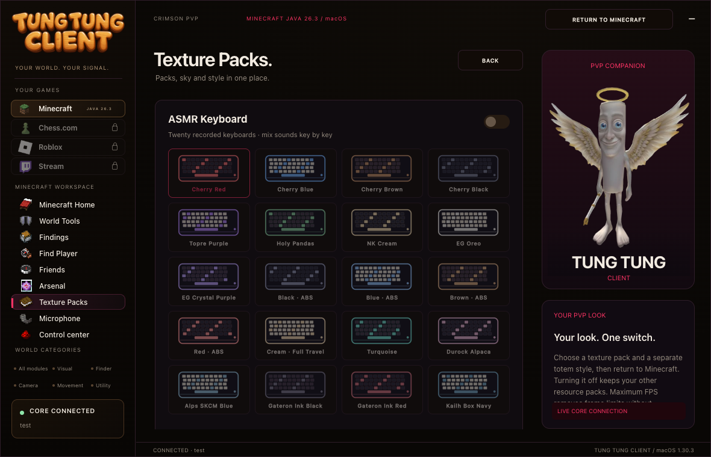
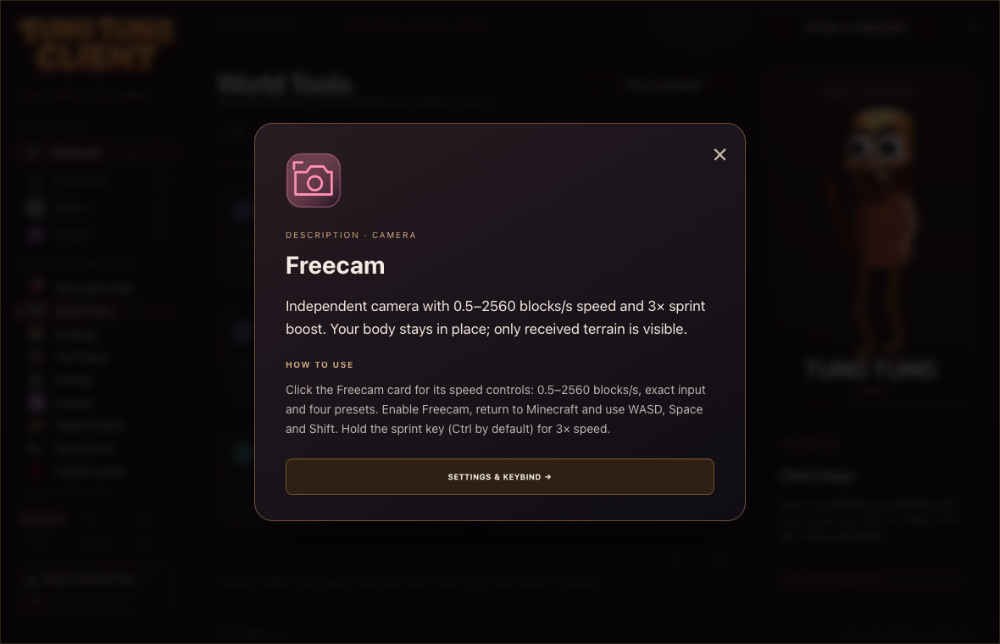

# Tung Tung Client

Desktop companion for Minecraft Java, with separate Mac and Windows packages.

**Current desktop: 1.30.7 · Game core: 1.30.3 · Minecraft 26.3 · Fabric Loader 0.19.5 · Java 25**

## Download

[Download the latest release](https://github.com/ilovepiton/tung-tung-client/releases/latest)

[Mac download](https://github.com/ilovepiton/tung-tung-client/releases/download/v1.30.7/Tung-Tung-Client-Mac-1.30.7-Voice-Chat.zip) · [Windows download](https://github.com/ilovepiton/tung-tung-client/releases/download/v1.30.7/Tung-Tung-Client-Windows-1.30.7-Voice-Chat.zip) · [All files](https://github.com/ilovepiton/tung-tung-client/releases/tag/v1.30.7)

Choose your package:

| File | Use |
| --- | --- |
| `Tung-Tung-Client-Mac-1.30.7-Voice-Chat.zip` | macOS 13+, Apple Silicon and Intel, Simple Voice Chat |
| `Tung-Tung-Client-Windows-1.30.7-Voice-Chat.zip` | Windows 10/11 x64, Simple Voice Chat |
| `Tung-Tung-Client-1.30.7-Voice-Chat-Prism.zip` | Importable Prism Launcher instance |
| `Tung-Tung-Client-1.30.7-Share.zip` | All platforms, instructions and source snapshot |

Extract the whole archive. Close Minecraft and Launcher, install the Fabric core
from **Control center**, then launch **Tung Tung Client 26.3** and join a world.
Updating the desktop app alone does not replace the loaded game core.

## Quick help / установка

- [Простая установка на русском](docs/EASY-SETUP-RU.md)
- [Windows quick start](windows/START-HERE.txt)
- [Mac details](macos/README.txt)
- [Changelog](docs/CHANGELOG.md)
- [Updates and future plans](docs/UPDATES.md)
- [Build and dependency notes](docs/BUILD.md)

## Workspaces

- **World Tools / Findings** — received-world observations, map art, camera and visual controls.
- **Arsenal** — combat and inventory modules, with separate switches and keybind settings.
- **Texture Packs** — resource packs and visual customization.
- **Microphone** — Simple Voice Chat setup.
- **Stream** — visible but locked in this release.
- **Chess.com / Roblox / Stream** — locked in this release.

Server permissions, protocol compatibility and the data received by the game
determine which modules can work. A private server alone does not add a Roblox
runtime; this package does not include an executor or injector.

## New in desktop 1.30.7

The ordinary Tung Tung Client bundles official Simple Voice Chat 2.6.27+26.3
on Mac, Windows and Prism. Installers replace the older managed voice mod.
Fixed Windows installer checks for desktop version and all five bundled mods.
Game core remains 1.30.3. No diagnostic profile is shipped.

Voice Chat 2.6.27 starts successfully on Mac, but DonutSMP voice negotiation
remains unresolved. This update does not claim to fix that connection.

## Features retained from 1.30.3

- Distinct Minecraft item PNGs for 43 modules; Elytra Finder keeps Elytra and Freecam uses phantom membrane.
- Twenty miniature keyboard designs in Texture Packs and per-key customization.
- Readable description dialogs with usage instructions and settings links.
- Find Player shows actual skin faces beside online players, with loading placeholders.
- Chess.com, Roblox and Stream stay visible with locks; their pages cannot be opened.
- Game core 1.30.3 supplies faces, fetched in the background from advertised official skin textures.

## Interface preview

Original keyboard designs and readable module descriptions. Screenshots show the interface with test data.

## Map art

**Texture Packs → Map Art** contains two separate modules, enabled by default in
this game core:

- **Client Maps 1.3.4** stores received map pixels per server.
- **Map in Slot 3.5.0** previews maps in inventory slots.

Both have independent toggles and keybind settings. Map in Slot is adapted to
read the runtime toggle; its MIT license and patch source are included.

## Validation

Mac: native app self-test, signature checks and isolated Minecraft 26.3 startup
passed. Both map mods loaded. Rendering with an actual server map was not
visually verified in that test. Windows: cross-compilation passed without
compiler diagnostics; Windows runtime/gameplay has not been tested on Windows.
Archive CRCs and distribution SHA-256 checks passed.

## Updates

Updates are manual in this release. A release feed, version comparison and
in-app update notification are planned, without a promised date. See the update
instructions before replacing an existing installation.

## License and credits

Project source: [MIT](LICENSE). Third-party components keep their own licenses.
See [compatibility notices](packaging/COMPATIBILITY-MODS-NOTICE.txt) and the
licenses bundled with each release. Minecraft, Java and account data are not
included. GitHub release downloads are listed in SHA256SUMS for verification.
